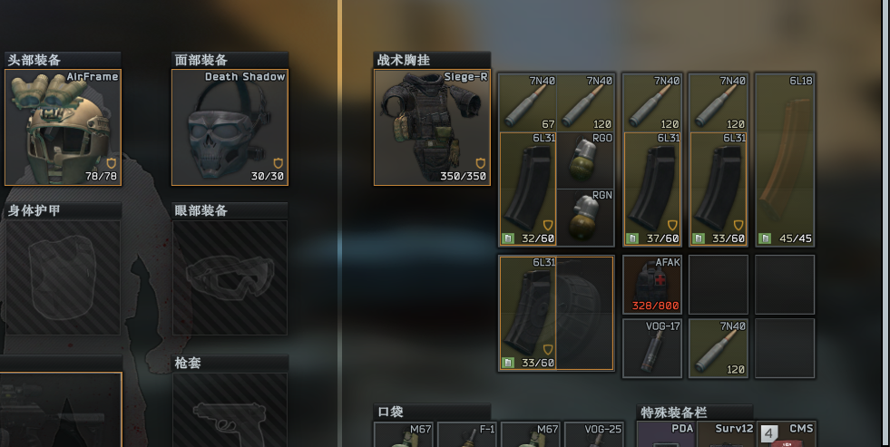

<video src="https://raw.githubusercontent.com/WYYQWQ-1/Kirisame-Mag-Reload/main/screenshots/demo-1.mp4" controls loop muted playsinline width="720"></video>

<video src="https://raw.githubusercontent.com/WYYQWQ-1/Kirisame-Mag-Reload/main/screenshots/demo-2.mp4" controls loop muted playsinline width="720"></video>

**SPT 4.1.6 — Mono.** Swap your magazines in place instead of stuffing the old one into your backpack or losing it on the ground.

## What it changes
- **In-place swap** — the magazine you load takes the gun, the old one takes the cell the new magazine was in (same size, or the old one is smaller).
- **Reorder when the old one is bigger** — e.g. a drum into a small cell: the new magazine goes into the gun first, the old one is placed into the freed area, moving one blocker aside if needed.
- **Fallback, never drop** — if the game itself finds no free cell, the old magazine goes to vest → pockets → backpack, then moves back once the reload animation ends.
- **One notice** — bottom-right if there is truly no space anywhere.

## Compatibility
- **UI Fixes**: if its in-place reload is ON, this mod steps back. Enable **Take over reload** to disable UI Fixes' swap at runtime (its config file is never modified).
- **Fika (experimental)**: co-op swaps go through Fika's own inventory transaction; bots and other players are untouched. Both sides need the same mod version. With an empty chamber the co-op reload falls back to vanilla.
- Works with all real magazine sizes (1x1 … 2x3) via real width/height and rotation.

## Config (F12)
`General`: Enable · In-place swap · Take over reload · Language (auto / 中文 / English)
`Debug`: Verbose log

## Reporting bugs
Logs are English and prefixed `[KMR]`. Attach `BepInEx/LogOutput.log`.

## Source
https://github.com/WYYQWQ-1/Kirisame-Mag-Reload — MIT

## 中文说明
换弹时把旧弹匣放进「新弹匣原来的格子」：同尺寸或旧弹匣更小会直接对换；旧弹匣更大时走重排，必要时挪开一件挡路的物品。游戏自己找不到位置时，按 弹挂 → 口袋 → 背包 兜底，换弹结束后再挪回；真的没位置才会掉在地上（右下角提示）。与 UI Fixes 并存时会自动让路，也可以在 F12 打开「接管换弹」；联机（Fika）为实验性，走 Fika 自带库存事务，两端需同版本，空膛时退回原版。
