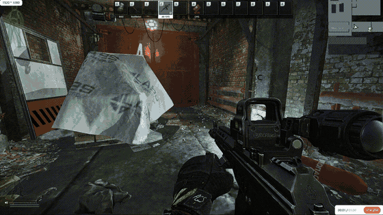
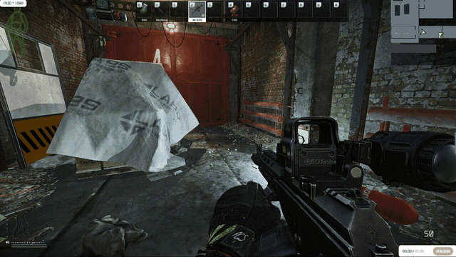

# Kirisame Mag Reload —— 换弹原地对换 / 不再掉弹匣（SPT 4.1.6）

**中文名：弹匣原地对换**
作者：Kirisame dish
版本：1.1.0
支持：SPT 4.1.6（Mono）

---

## 演示





---

## 它做什么

平时换弹，如果弹挂和口袋都满了，原版会把旧弹匣塞进背包、甚至直接扔地上。
这个插件改成：**旧弹匣直接放进"新弹匣原来的格子"**，不过背包、不掉地。

具体分三种情况：

1. **同尺寸，或旧弹匣更小** —— 直接原地对换，旧弹匣进新弹匣的格子，新弹匣上枪。
2. **旧弹匣更大**（比如 60 发弹鼓换 30 发）—— 走重排：先把新弹匣插进枪，再把旧弹匣放进腾出来的区域；需要时会把挡路的物品挪开一件。
3. **游戏自己找不到位置** —— 按 弹挂 → 口袋 → 背包 兜底，换弹结束后再挪回弹挂空位；真的完全没有位置，才会掉地上，并在右下角提示。

支持所有实际尺寸（1x1 / 1x2 / 1x3 / 2x2 / 2x3），读取真实宽高和旋转，不写死形状。

### 联机（Fika）

联机换弹也会这样做原地对换，旧弹匣不再绕道背包。

**注意：只经过主机侧测试，客机（真两机联机）尚未测试。** 遇到问题请把游戏根目录下的 `KMR-diagnostics.txt` 发出来（F12 → Debug → 勾一下「导出诊断日志」就会生成）。

双方需要装**同版本**本插件；只装一边会导致两边不一致。

---

## 安装

把压缩包内容解压到游戏根目录即可：

```
BepInEx/plugins/SmartMagReloadMono/SmartMagReloadMono.dll
```

进游戏按 F12 可以看到设置。

---

## 设置（F12）

`General / 常规`

- **Enable / 启用** —— 总开关，关掉完全用原版
- **In-place swap / 直接交换** —— 能对换时原地对换
- **Take over reload / 接管换弹** —— 见下面「和 UI Fixes 的关系」
- **Language / 语言** —— 自动跟随游戏语言（中文用户显示中文）

`Debug / 调试`

- **Verbose log / 详细日志** —— 排错用，平时关掉

---

## 和 UI Fixes 的关系

如果你装了 UI Fixes 并且打开了它的「Reload Magazines In-Place」：

- 默认：本插件**自动让路**，只做落点兜底，不跟它抢
- 想让自己接管：把 F12 里的 **接管换弹** 打开
  - 它会在运行时把 UI Fixes 的那段交换逻辑关掉（**不会修改 UI Fixes 的配置文件**）
  - 打开后立刻生效，不用重启

---

## 联机（实验性）

- 联机换弹走的是 **Fika 自带的库存事务**，不是我们自己发的网络包
- 机器人和其他玩家完全不受影响，本插件只处理你自己的换弹
- 两端必须是**同一个版本**（Fika 本身会校验 mod）
- 空膛时联机换弹会退回原版（见下面的已知限制）

**还没有经过双人实测**，所以标成实验性。

---

## 已知限制

1. **联机 + 空膛**：膛里没弹时不做原地交换，退回原版换弹（旧弹匣可能进空位或掉地）
   原因：原版在换弹末尾会自动补一发进膛，而我们跳过原版流程时还没有复刻这一步
2. **联机交换后**，枪的弹匣视觉/人机可能滞后，切一次枪就恢复
3. 联机下不做「旧弹匣更大」的重排对换（避免两端不同步）

---

## 出问题时怎么反馈

日志是英文的，全部带 `[KMR]` 前缀，方便外部排查。
请附上 **BepInEx/LogOutput.log**，并说明：

- 单机还是联机、双方插件版本
- 换的什么枪、什么尺寸的弹匣
- 看到的异常（没反应 / 掉地上 / 位置不对）

---

## 下载

- 模组页（SPT Forge）：https://sp-mod.com/mod/3364/kirisame-mag-reload-in-place-magazine-swap-no-drop-fix
- GitHub：https://github.com/WYYQWQ-1/Kirisame-Mag-Reload
- 源码与更新日志都在仓库里，MIT 许可
